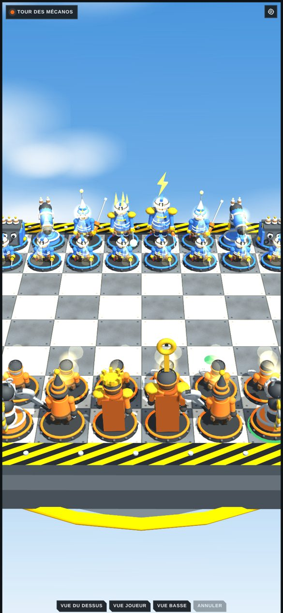
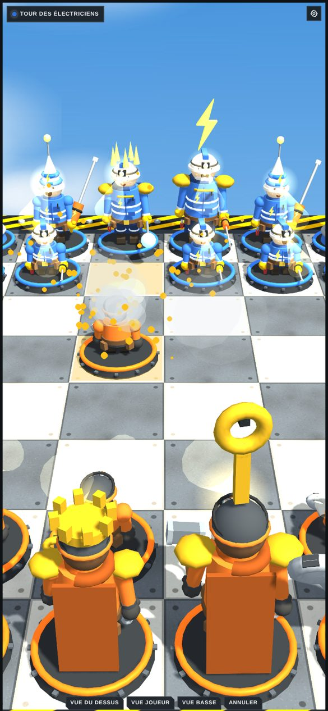
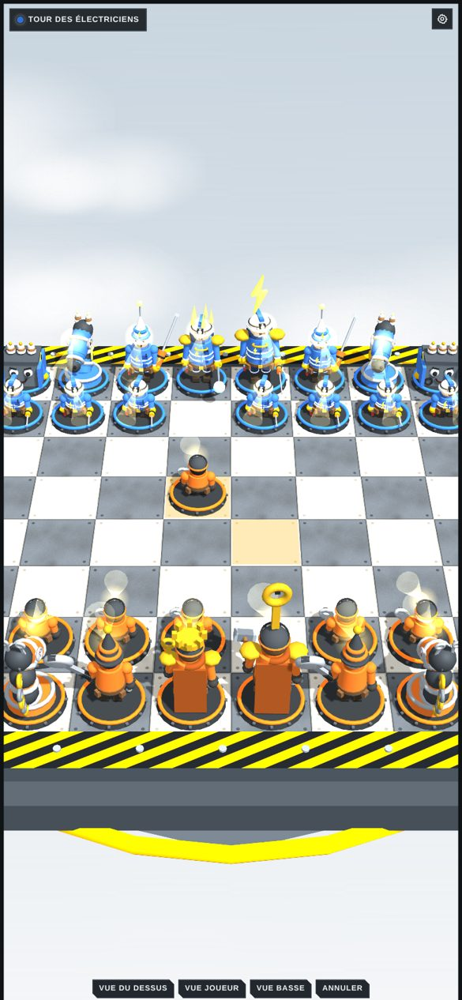

# Échecs Industriels

Jeu d'échecs en 3D : **Mécanos** (orange, jouent en premier) contre **Électriciens** (bleu), dans un univers industriel. Jouable sur téléphone.

## ▶ Jouer

**[Ouvrir le jeu](https://claude.ai/artifact/6gLTDqg1C8wcbgMKiBMHGH)** (dans l'app Claude ou le navigateur, compte connecté).

Le mode en ligne fonctionne depuis ce lien : l'autre joueur doit avoir accès à l'artefact en tant que *Contributeur* (menu Partager).

## Captures

  
  
  
  

  
  
  

Menu de démarrage, partie, déplacements possibles, vue du dessus, combat pendant une prise, ciels Coucher et Brume.

## Fonctionnalités

- **Modes** : contre l'ordinateur (Débutant, Facile, Moyen, Expert), à deux sur le même téléphone, en ligne avec un code de partie.
- **Personnages animés** et combats différents selon la pièce, au hasard ; durée réglable (Courts, Moyens, Longs). Un toucher passe le combat.
- **Ambiance** : ciel Jour, Coucher de soleil ou Brume ; plateau flottant, effet poussière, lampes de casque.
- **Caméra libre** : rotation, vue du dessus, vue basse, zoom, déplacement à deux doigts.
- **Aide** : affichage des déplacements possibles (réglable en cours de partie), annulation du coup.
- **Son** : musique d'atelier et bruitages, coupables séparément.

## Fichiers

- `index.html` : le jeu complet en un seul fichier (Three.js chargé depuis cdnjs).
- `src/` : sources séparées (moteur d'échecs et IA, audio, scène, pièces, animations, interface).

## Jouer hors de Claude

Ouvrir `index.html` dans un navigateur suffit pour jouer contre l'ordinateur ou à deux. Le mode en ligne dépend de la connexion de l'artefact Claude et ne marche pas en dehors.
