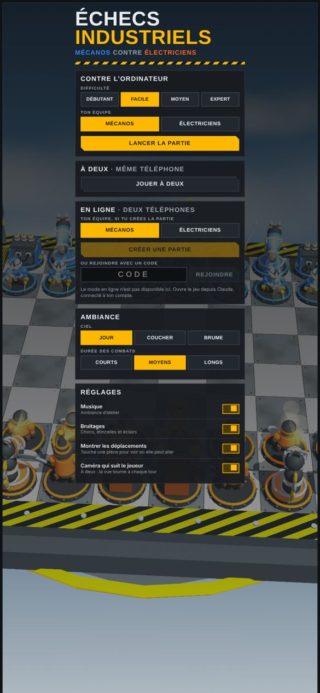
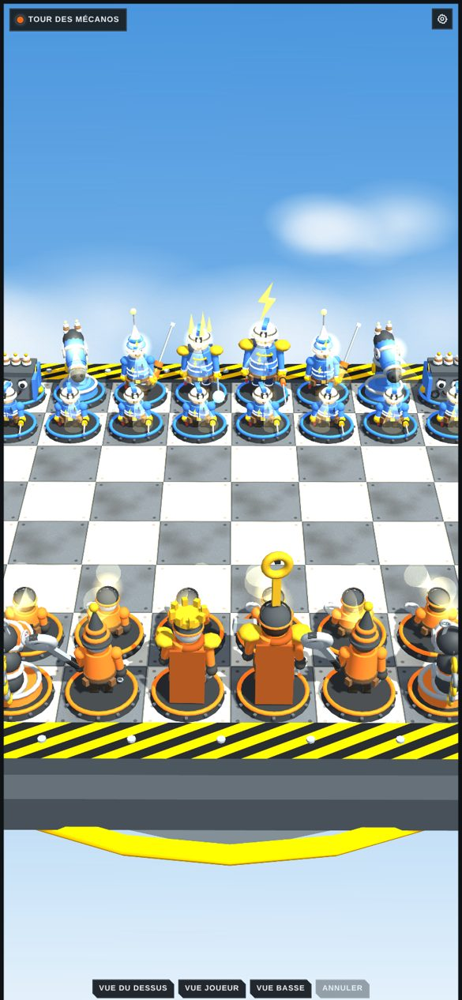
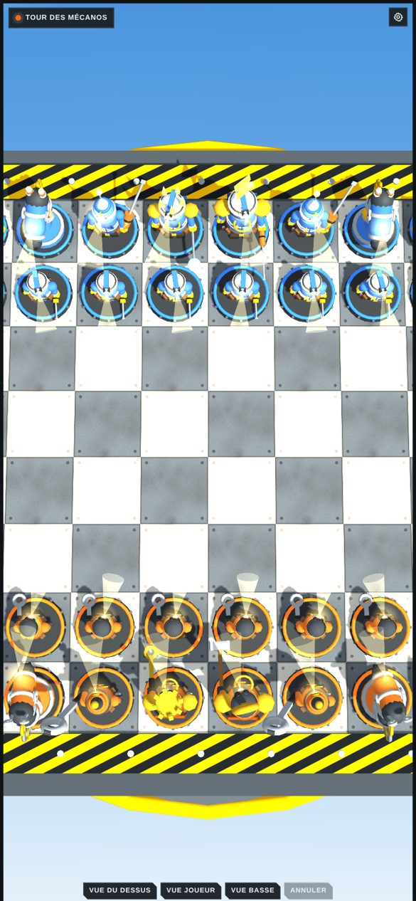
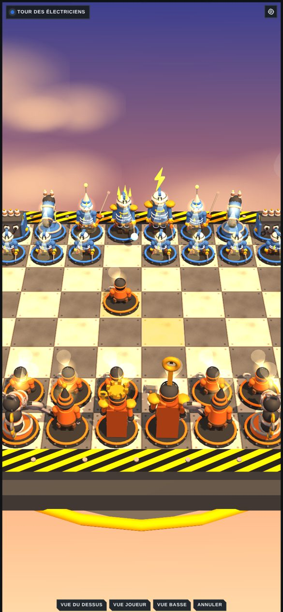

# Échecs Industriels

Jeu d'échecs en 3D : **Mécanos** (orange, jouent en premier) contre **Électriciens** (bleu), dans un univers industriel. Jouable sur téléphone.

## ▶ Jouer

**[https://gt61113.github.io/Echeque-industriel-/](https://gt61113.github.io/Echeque-industriel-/)**

Ouvre le lien sur ton téléphone ou ton ordinateur : contre l'ordinateur (4 niveaux), à deux sur le même appareil, ou à deux téléphones en connexion directe.

### Connexion directe (deux téléphones)

1. Le premier joueur ouvre le jeu, choisit son équipe, touche **Créer une partie** et reçoit un code à 4 lettres.
2. Le second ouvre le même lien, entre le code et touche **Rejoindre**.
3. La partie démarre : les coups passent directement d'un navigateur à l'autre (WebRTC avec PeerJS), sans compte ni installation.
4. Si la liaison directe ne s'établit pas au bout de 7 secondes (réseaux d'entreprise, certaines connexions mobiles), le jeu bascule automatiquement sur une passerelle internet publique (MQTT). Le jeu reste le même, seul le trajet des messages change.

## Captures

  
  
  
  

  
  
  

Menu de démarrage, partie, déplacements possibles, vue du dessus, combat pendant une prise, ciels Coucher et Brume.

## Fonctionnalités

- **Modes** : contre l'ordinateur (Débutant, Facile, Moyen, Expert), à deux sur le même téléphone, en connexion directe entre deux navigateurs avec un code de partie.
- **Personnages animés** et combats différents selon la pièce, au hasard ; durée réglable (Courts, Moyens, Longs). Un toucher passe le combat.
- **Ambiance** : ciel Jour, Coucher de soleil ou Brume ; plateau flottant, effet poussière, lampes de casque.
- **Caméra libre** : rotation, vue du dessus, vue basse, zoom, déplacement à deux doigts.
- **Aide** : affichage des déplacements possibles (réglable en cours de partie), annulation du coup.
- **Son** : musique d'atelier et bruitages, coupables séparément.

## Fichiers

- `index.html` : le jeu complet en un seul fichier (Three.js chargé depuis cdnjs).
- `src/` : sources séparées (moteur d'échecs et IA, audio, scène, pièces, animations, interface).
